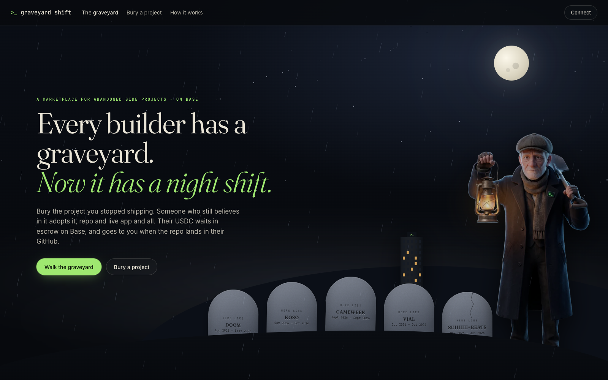

# Graveyard Shift

**The marketplace for abandoned side projects.**

Sell the project you stopped working on, or buy one and finish it. A seller lists a public GitHub repo and Claude writes
an honest review for buyers. A buyer pays in USDC, which is held in an escrow contract on Base and released to the
seller automatically once the repo is transferred to the buyer's GitHub account.

Not ready to sell? Launch the project as a **token** on a bonding curve instead. The founder gets no tokens. Instead 2%
of every trade goes into a founder pot that they can withdraw only while the repo has a commit in the last 30 days,
which our keeper reads from GitHub and records on-chain. Founders get paid for shipping, not for launching.

Live: **https://graveyard.nerom.site** · Built for Vibeathon 02 (Night Shift) on Vibestarter.



Contracts on Base Sepolia (source verified on Sourcify):
- Escrow (`Graveyard.sol`): [`0x74d0C081C24A22e1170dd357a00a9dA25cD335d8`](https://sepolia.basescan.org/address/0x74d0C081C24A22e1170dd357a00a9dA25cD335d8)
- Token launchpad (`Seance.sol`): [`0x750d7855Cd4e59bb8909F43eC18AB7FcC13347FA`](https://sepolia.basescan.org/address/0x750d7855Cd4e59bb8909F43eC18AB7FcC13347FA)
- gUSDC test token: [`0x56B5fA16b3f32DcaE2980e17fc967e163409cFca`](https://sepolia.basescan.org/address/0x56B5fA16b3f32DcaE2980e17fc967e163409cFca)

## What to try

1. **Browse the projects.** Each headstone is a real, dormant public repo, drawn from its data:
   - the stone gathers moss after a month without a commit, and cracks and leans after four;
   - the green glow behind it is the review's *revival score*: how easy it is to pick back up;
   - a lantern burns while a sale sits in escrow, and sold projects wear a flower garland;
   - projects with a token get a ghost that climbs out as the token fills its funding goal, and one candle per holder.
2. **Open a project.** Read Claude's review: why it stalled, findings, what's worth keeping, a three-step plan to finish
   it, the best-fit buyer, and a suggested price next to the asking price.
3. **Sell a project.** Paste any public GitHub repo. Claude reads the repo facts, the README and the commit history, and
   writes the review live, in about 10 seconds. Set your price and sign one message (no gas) to list it.
4. **Buy a project token.** Open "Launch a token" and pick a live one ($KOSO, $GWEEK…). The panel shows the funding
   bar toward the 1,500 USDC goal, the founder pot, and whether the repo is active.
5. **Buy a project.** Connect a wallet. A Base Account works with just a passkey, and approve plus buy go through as one
   atomic bundle. Grab 1,000 test USDC from the built-in faucet, which also sends a sip of gas. Then pay on Base
   Sepolia and name the GitHub account the repo should go to.

## How a sale works

```
buyer ──adopt(listing, seller, amount, 3 days)──▶  Graveyard escrow (Base)
                                                     │
seller transfers repo on GitHub ──▶ verifier sees owner == buyer's GitHub ──▶ attest() ──▶ seller paid (−2.5% fee)
                                                     │
buyer can confirm() any time · seller can refund() any time · buyer can refund() after the window
```

- `contracts/src/Graveyard.sol` is the escrow: one open deal per listing; release by buyer confirmation or by the
  verifier's attestation; refunds by the seller at any time or by the buyer after the deadline; a capped fee.
  There are 11 Foundry tests.
- `contracts/src/GraveUSD.sol` is a 6-decimal test USDC so anyone can try it on Base Sepolia. On mainnet the escrow
  points at real USDC.
- The verifier is the server's keeper. Every 75 seconds it checks each open deal's repo owner through the GitHub API,
  falling back to github.com's own transfer redirect, and calls `attest` when the repo has moved.
- Listings are signed by the seller's wallet (EIP-191, with smart-wallet signatures verified through ERC-6492/1271), and
  the server re-runs the review itself, so a seller can't hand-write their own report.
- Owners can add a `.graveyard` file holding their wallet address to the repo to earn a verified badge.

## How project tokens work

```
founder signs "raise $KOSO"  ──▶  verifier relays launch()  ──▶  Spirit ERC20 + curve in the Séance contract
believers buy()/sell() on a virtual constant-product curve (1,000 USDC × 1B tokens), USDC reserve backs every sell
3% fee per trade: 2% → revival pot, 1% → treasury          reserve ≥ 1,500 USDC → Risen
keeper sees a new commit on GitHub ──▶ pulse() ──▶ founder may claim() the pot for 30 days (only once risen)
repo adopted through the escrow ──▶ setFounder(adopter): the pot follows the project
```

- `contracts/src/Seance.sol` holds the launchpad and the `Spirit` ERC20, which only the Séance can mint or burn. There
  are 11 Foundry tests, including a fuzz test that the reserve always covers every sell.
- Launches go through the verifier after a wallet signature from the plot's founder (the seller, or the adopter once
  it's handed over), so only the right wallet can raise a project and the founder pays no gas.

## Stack

- **Contracts:** Solidity + Foundry (22 tests), deployed on Base Sepolia.
- **App:** React + Vite, wagmi/viem, and a Base Account connector (passkey smart wallet, EIP-5792 batched calls).
- **Server:** plain Node: a JSON store on a Railway volume, viem for the keeper/verifier/faucet, the GitHub REST API,
  and the Anthropic SDK.
- **Reviewer:** Claude Opus 5.5 with structured outputs (a zod schema) and server-side refusal fallback. A rule-based
  report takes over if the model is unavailable.

## Built with

Built in one night shift with Claude Code: contracts, tests, server, UI and deploy, driven from a single conversation.
Claude also runs inside the product as the reviewer.

## Run it

```bash
npm install
cd contracts && forge test && cd ..
# deploy: DEPLOYER_KEY=0x… forge script contracts/script/Deploy.s.sol --rpc-url https://sepolia.base.org --broadcast
# env: ANTHROPIC_API_KEY, DEPLOYER_KEY (verifier + faucet), GRAVEYARD_ADDRESS, GUSD_ADDRESS, GITHUB_TOKEN (optional), DATA_DIR
npm run build && npm start      # http://localhost:8787
```

The seed listings are the founder's own dormant repos, reviewed by `scripts/seed.mjs`.
